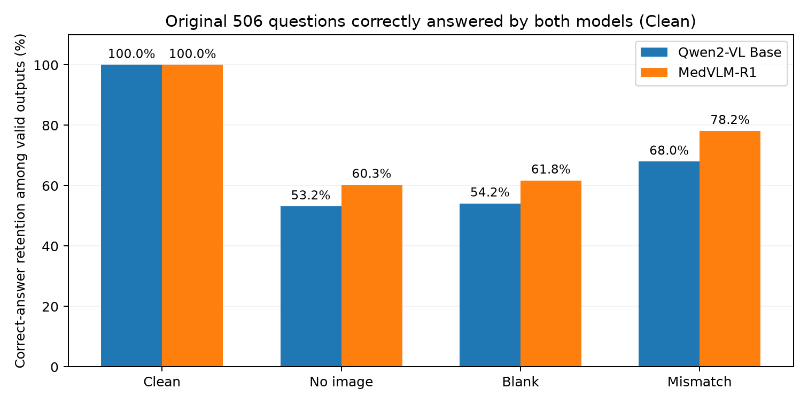
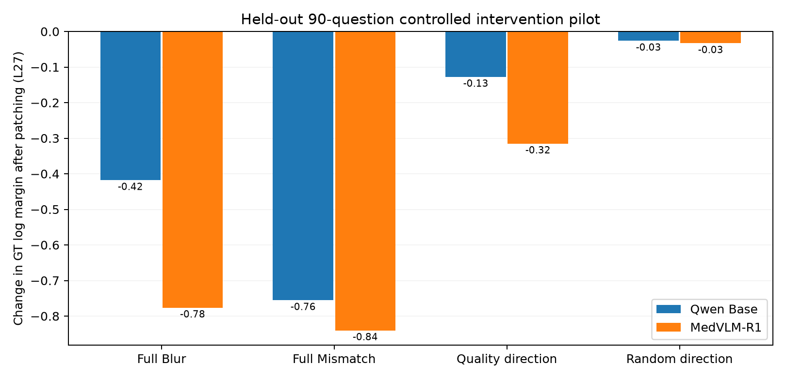
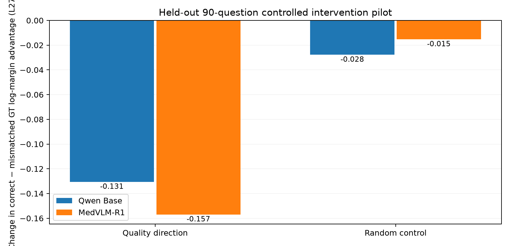
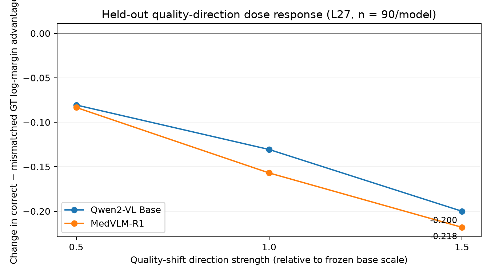

# Visual Reliance and Post-Training Gains in Medical VLMs

*Research progress — 9 October 2026*
[Experiment code and results](https://github.com/bbuller591-sketch/medical-vlm-visual-reliance)

## 0. Research Questions and Experimental Setup

We study two connected questions. **First, how much does a medical VLM's answer depend on the current image, especially when the original answer is correct?** In medical settings, the usefulness of visual evidence also depends on image quality. We therefore ask how visual reliance changes as an image becomes degraded, and whether the model adjusts its use of visual evidence accordingly.

**Second, what accounts for the accuracy gains after medical-VQA reinforcement learning (RL)?** Our experiments revealed substantial gains from the RL-trained checkpoint even when the image was removed. This motivates examining how much post-training improvement comes from the current visual evidence versus non-visual information, such as existing medical knowledge and question–answer patterns.

We compare **Qwen2-VL-2B-Instruct** (Base) and **MedVLM-R1** (RL checkpoint), primarily using an official **900-question medical VQA benchmark** covering MRI, CT, and X-ray images. Its **825 four-choice questions** provide a common format for direct comparisons of Base and RL; the full 900 questions are used for image-quality analysis. Additional medical VQA benchmarks examine how the findings transfer across tasks.

Our main approach is to **keep the question and answer choices fixed while changing the visual input**: the original image (Clean), no image, a different medical image (Mismatch), or progressively blurred images. We compare answer accuracy, the correct answer's score relative to alternatives, and answer uncertainty. Appendix 0 details the dataset composition, input conditions, a concrete example, and the common evaluation protocol.

## 1. Does the Model Use the Current Image?

We first kept each question and answer set fixed while removing or replacing its image. On the **825 four-choice questions**, both checkpoints benefited from seeing the original image, with lower accuracy when the image was omitted or replaced by another real medical image:

| Model | Clean | No-image | Mismatch |
|---|---:|---:|---:|
| Qwen2-VL Base | **64.7%** | 43.4% | 50.2% |
| MedVLM-R1 | **81.5%** | 55.7% | 69.6% |

To study answers that were *initially correct*, we further examined the **506 questions answered correctly by both models with Clean images**. The proportion of correct answers retained after each intervention was:

| Visual input | Qwen2-VL Base | MedVLM-R1 |
|---|---:|---:|
| Clean | **100%** | **100%** |
| No-image | 53.2% | 60.3% |
| White blank | 54.2% | 61.8% |
| Mismatch | 68.0% | 78.2% |

These results show that the **correct image–question pairing matters** beyond the mere presence of a medical image. The distinction between image presence and useful current-image content motivates studying how this benefit changes with image quality. Per-condition valid counts, within-model comparisons, and additional interventions appear in **[Appendix 1](#appendix-1.-behavioral-evidence-for-reliance-on-the-current-image)**.

## 2. How Does Image Quality Affect Visual Reliance?

### 2.1. Visual Reliance under Image Degradation

We varied Gaussian blur while keeping each medical question and its choices fixed. On the **900 official questions**, we measured the correct image's advantage over three same-modality mismatched donor images **at the same blur level**, using the difference in ground-truth (GT) log margin. We included the original four quality levels and an additional 4-pixel sensitivity condition:

| Image quality | Approx. Gaussian $\sigma$ | Qwen2-VL Base: correct-image advantage | MedVLM-R1: advantage |
|---|---:|---:|---:|
| **Clean** | 0 px | **0.730** | **0.894** |
| Mild | 2 px | 0.736 | 0.883 |
| Additional sensitivity check | 4 px | 0.599 | 0.742 |
| Medium | 6 px | 0.543 | 0.647 |
| **Severe** | 12 px | **0.211** | **0.228** |

Correct-image advantage stayed similar under mild blur but decreased substantially under stronger degradation, as candidate-answer entropy increased. **The degradation weakens the predictive support supplied by the correct image in both checkpoints.** The precise margin definition, modality breakdown, and entropy measurements are in **[Appendix 2.1](#image-degradation-and-quality-by-relevance-design)** and **[Appendix 2.2](#behavioral-quality-sensitivity)**.

### 2.2. Visual–Text Evidence Competition

We then asked whether weaker or mismatched visual evidence makes a model more susceptible to **external textual advice**. We selected **559 four-choice questions correctly answered with Clean images by both checkpoints using the same candidate-scoring protocol**. For every question, we separately suggested A, B, C, or D, with an adaptive confidence computed from **each model's own Clean prediction probability**. The numeric confidence was fixed for that model/question across all visual conditions.

**Hint following rate** is the fraction of the three suggestions *different from the current no-hint predicted option* that cause the model to switch to the suggested option:

| Visual input | Qwen2-VL Base | MedVLM-R1 |
|---|---:|---:|
| Clean | **66.1%** | **40.5%** |
| Severe Blur | 82.3% | 66.3% |
| Mismatch | 70.5% | 48.7% |
| No-image | 89.5% | 81.8% |

Both models followed textual suggestions more often when the image was severely blurred or removed. R1 followed advice less often under every visual condition, while showing a larger **Clean-to-Severe increase** (+25.82 percentage points [pp] versus +16.28 pp for Base). Random Mismatch produced a smaller change. **The experiment measures how strongly external text competes with image-conditioned decisions.** Each checkpoint received confidence statements derived from its own Clean predictions; the paired quality changes therefore provide the clearest comparison of how susceptibility responds to image degradation. Detailed controls and statistics appear in **[Appendix 2.3–2.5](#visualtext-evidence-competition-559-item-protocol)**.

### 2.3. Decision-Token Intervention: Modulating Visual Evidence

We further tested whether a quality-associated internal change can affect the contribution of the current image **without changing its pixels**. Using **450 separate questions** to estimate the mean Severe-Blur-minus-Clean activation direction, we added this direction at **decoder layer 27, at the final prompt/decision-token residual state**, on **90 held-out questions per checkpoint**. The model weights and the actual input image remained unchanged.

| L27 quality-direction intervention | Qwen Base | MedVLM-R1 |
|---|---:|---:|
| Change in correct-image content advantage (Clean − Mismatch GT log margin) | **−0.131** | **−0.157** |
| Change in Clean GT log margin | −0.128 | −0.315 |
| Change in Clean answer entropy | +0.071 | +0.092 |

The learned direction reduced the benefit of the correctly paired image more than an equal-norm random direction, with a stronger response at higher intervention doses. It also increased answer entropy in **No-image** inputs (+0.058 for Base; +0.095 for R1). **Decision-token representations modulate visual-content support and broader answer uncertainty at the same time.** The full-state replacement, held-out controls, and dose-response results are retained in **[Appendix 2.6–2.9](#representation-evidence-quality-versus-content)**.

### 2.4. Main Findings

**(1) Image quality matters:** Both models lose correct-image predictive advantage as blur becomes more severe. **(2) RL strengthens image-conditioned decision stability while leaving quality-aware reliance underdeveloped:** R1 follows competing textual advice less often than Base under Clean, Severe Blur, and Mismatch. Its stronger commitment persists with degraded or mismatched images, while loss of visual evidence triggers substantial shifts, especially on MRI. **(3) Medical RL improves task accuracy more than evidence calibration:** R1 gains substantially even with No-image input, and the extra benefit of supplying the correct image remains almost unchanged. **Together, the results suggest that medical RL reinforces image-conditioned decisions and task-specific priors more effectively than reliable control over when and how much the image is trusted.**

**This leads to Part 3:** The next question is which capabilities drive the large medical-VQA accuracy gains while quality-aware visual reliance remains weak. We investigate image-free improvements, their concentration in the MRI training modality, and whether the image-free advantage persists even on questions both checkpoints already solve correctly with Clean images.

## 3. What Did RL Actually Improve?

### 3.1. Substantial Gains Persist without Images

The matched **825-question, four-choice** comparison shows that MedVLM-R1 improves with the original image and achieves a gain of similar magnitude with **No-image** input. Scores are averaged over three fixed option orders for each question.

| Input condition | Qwen2-VL Base | MedVLM-R1 | RL − Base |
|---|---:|---:|---:|
| Clean image | 68.89% | **80.97%** | **+12.08 pp** |
| No-image | 44.12% | **57.94%** | **+13.82 pp** |
| Clean − No-image benefit | +24.77 pp | +23.03 pp | **−1.74 pp** |

**The RL accuracy gain is reproduced at the same scale without any image:** +13.82 pp in No-image versus +12.08 pp in Clean. The incremental accuracy benefit of adding the current image changes by only −1.74 pp (95% paired CI [−3.80, +0.32]). The central improvement is a much stronger ability to recover benchmark answers from **non-visual signals**—medical knowledge, question wording, option plausibility, and dataset-specific answer patterns. An answer-accuracy reward can reinforce precisely these predictive patterns without requiring better visual grounding. Detailed paired statistics are in **[Appendix 3.1](#matched-scoring-clean-versus-no-image)**.

### 3.2. Gains Are Concentrated in the MRI Training Modality

The original MedVLM-R1 GRPO training uses MRI examples. The matched evaluation shows that its improvement is strongly concentrated in MRI, both with and without images:

| Modality | RL − Base, Clean | RL − Base, No-image |
|---|---:|---:|
| **MRI (n=300)** | **+29.11 pp** | **+32.11 pp** |
| CT (n=237) | +4.36 pp | +5.49 pp |
| X-ray (n=288) | +0.69 pp | +1.62 pp |

**MRI No-image accuracy reaches 75.67% after RL, compared with 43.56% for Base**, even though the diagnostic image is absent. The No-image gain on MRI (+32.11 pp) is greater than the Clean gain (+29.11 pp), whereas the corresponding gains on CT and X-ray are much smaller. This marked concentration in the **MRI training modality** points to **reward-driven strengthening of MRI-specific medical and benchmark question–answer regularities** as the dominant observed post-training effect. The complete breakdown is in **[Appendix 3.2](#where-are-the-gains-concentrated-mri-versus-ct-and-x-ray)**.

### 3.3. The No-Image Advantage Persists on Questions Both Models Already Solve

We examined **559 four-choice questions that both models already answered correctly with Clean images**, using the same O0 candidate-scoring protocol. We then removed the images and compared the two checkpoints on these identical questions.

| Clean-correct subset / No-image evaluation | Qwen2-VL Base | MedVLM-R1 | RL − Base |
|---|---:|---:|---:|
| **All 559 questions** | 51.52% (288/559) | **62.25% (348/559)** | **+10.73 pp** |
| **MRI 207 questions** | 45.89% (95/207) | **71.50% (148/207)** | **+25.60 pp** |

The overall No-image advantage is **+10.73 pp** (95% paired CI [+7.87, +13.60]); **66** questions are answered correctly only by R1 versus **6** only by Base. Importantly, **R1 retains this advantage on questions Base could already answer with the original image**. Combined with the particularly large MRI effect and the final-answer accuracy reward, these results strengthen the case for **reward-amplified learning of medical and dataset-specific question–answer patterns** as a main source of the improved answer recovery. The complete paired results and the older 506-item diagnostic appear in **[Appendix 3.3–3.4](#matched-559-item-joint-clean-correct-subset)**.

### 3.4. Interpretation: What the Reward Encourages

MedVLM-R1's GRPO objective rewards **correct final answers and the required output format**. It provides a strong incentive to learn medical and dataset-specific patterns predictive of the answer, with no explicit reward for matching the answer to reliable evidence in the current image. The experiments reveal the expected consequence of that incentive: **large accuracy gains survive image removal, are concentrated in the MRI training modality, and persist even on questions both models already solve with Clean images**. This strongly points to **reward-driven fitting of non-visual medical and benchmark-specific answer patterns** as a major contributor to the observed gains. In short, **medical RL improves benchmark answer selection while leaving calibration of visual-evidence trust as an unmet training objective**. The reward design and a direct image-free RL control are covered in **[Appendix 3.5–3.6](#why-the-medvlm-r1-reward-motivates-a-non-visual-prior-hypothesis)**.

## 4. Does Medical RL Generalize Beyond the Training Benchmark?

### 4.1. The MRI Gains Disappear on External Medical VQA

We evaluated the same Qwen2-VL Base and MedVLM-R1 checkpoints on **SLAKE** (355 English Yes/No test questions) and **PMC-VQA** (a frozen 1,000-question, four-choice test sample), keeping question sets, visual interventions, and candidate scoring matched within each dataset. We compare RL-minus-Base accuracy under the original image (**Clean**) and with the image removed (**No-image**):

| Evaluation set | RL − Base, Clean | RL − Base, No-image |
|---|---:|---:|
| Original MRI benchmark (300) | **+29.11 pp** | **+32.11 pp** |
| **SLAKE (355)** | **−5.77 pp** | **−2.68 pp** |
| **PMC-VQA (1,000)** | **+0.33 pp** | **−0.37 pp** |

The large MRI improvement **disappears on external benchmarks**: R1 performs **worse than Base on SLAKE** (Clean 62.25% versus 68.03%) and is approximately tied on PMC-VQA (45.43% versus 45.10%). The strong MRI No-image advantage also disappears on both external datasets. These results reinforce the Part 3 finding that **medical RL rewards training-task-specific, non-visual answer patterns more effectively than generalizable medical visual reasoning**. Full accuracies, paired intervals, and evaluation protocols appear in **[Appendix 4.1–4.2](#external-datasets-and-matched-evaluation)**.

### 4.2. The Image-Free Advantage Is Specific to the Original Benchmark

We repeated the Part 3.3 analysis: restrict each dataset to questions **both checkpoints answer correctly with Clean**, then measure whether those correct answers survive image removal.

| Jointly Clean-correct set | Base No-image | MedVLM-R1 No-image | RL − Base |
|---|---:|---:|---:|
| Original MRI (207 questions) | 45.89% | **71.50%** | **+25.60 pp** |
| SLAKE (209 questions) | 43.54% | 42.58% | −0.96 pp |
| PMC-VQA (448 questions) | 56.25% | 55.58% | −0.67 pp |

**The strong image-free advantage exists on the original MRI task but vanishes in both external jointly solvable subsets.** This isolates the main generalization pattern: the RL checkpoint becomes substantially better at selecting correct answers from the original task's text and option cues, while its enhanced answer recovery fails to carry over to other medical question distributions. See **[Appendix 4.3](#jointly-clean-correct-questions-on-external-data)**.

### 4.3. Correct-Image Benefits Remain Similar after RL

A shuffled-image control supplies a real medical image from a different question while keeping an image in the model input. The **Clean − Shuffled** accuracy gap measures how much the correct image–question pairing helps answer selection:

| External dataset | Base: Clean − Shuffled | MedVLM-R1: Clean − Shuffled |
|---|---:|---:|
| SLAKE | +15.21 pp | +13.10 pp |
| PMC-VQA | +15.77 pp | +16.03 pp |

Both models benefit from correct visual content. **R1 produces no consistent gain in that benefit after medical RL.** We also tested **47 SLAKE pairs with identical question text and modality but opposite dataset-annotated Yes/No answers**. The probability moved in the label-consistent direction for **40/47 (85.11%)** pairs under Base and **38/47 (80.85%)** under R1. This more tightly controlled image-content comparison likewise favors **task-specific reward learning over a general improvement in visual evidence use**. The paired construction and VQA-RAD supplementary results are in **[Appendix 4.4–4.5](#image-content-relevance-and-opposite-label-pairs)**.

## 5. Discussion and Research Implications

### 5.1. Visual Evidence Is Used, but Reliance Is Poorly Regulated

Clean-to-Mismatch performance changes, quality degradation, text-advice competition, and decision-token interventions all reveal **behavioral and internal sensitivity to visual content**. The remaining challenge is **evidence-dependent regulation**: the model needs to reduce confidence in unreliable or irrelevant visual evidence and prioritize the relevant evidence when it is diagnostic. R1's lower susceptibility to competing text under degraded or mismatched images suggests that medical RL may strengthen visual commitment **without a corresponding improvement in reliability-aware reliance**.

### 5.2. Accuracy Rewards Reinforce Task-Specific Answer Patterns

The central pattern now spans three tests: **(i)** No-image gains on the original MRI benchmark rival Clean gains; **(ii)** those gains remain on MRI questions both models already solve with Clean images; and **(iii)** the gains disappear on SLAKE and PMC-VQA. Together they point to **reward-amplified use of MRI-specific medical, linguistic, and benchmark statistical regularities** as a major source of post-training improvement. The reward improves answer selection on the training-aligned task while leaving generalizable visual-evidence calibration underdeveloped.

### 5.3. The Evaluation Target Should Shift from Accuracy Alone

Medical VQA accuracy should be accompanied by tests of **correct-image contribution, visual degradation response, image–question mismatch, and evidence conflicts**. These measurements separate successful answer prediction from successful use of the current medical image. They also identify a natural training target: reward answers that follow reliable, task-relevant visual evidence, and encourage appropriate uncertainty when that evidence becomes weak.

## 6. Next Steps

**Priority 1 — Matched image-conditioned versus image-free RL.** Starting from the same Base checkpoint and MRI questions, train two policies with matched reward and optimization budget, one with images and one without. Compare Clean, No-image, shuffled-image, and external benchmark performance. This directly measures how much of the observed gain the answer-accuracy reward can reproduce from non-visual signals alone.

**Priority 2 — Reliability-aware visual-evidence reward.** Build a controlled training/evaluation set with image-quality gradients, question–image consistency checks, and dataset-annotated opposite-answer image pairs. Reward correct answers together with **appropriate sensitivity to reliable visual evidence**; evaluate answer accuracy, image-content advantage, and evidence-sensitive confidence.

**Priority 3 — Decision-token mechanism tests.** Extend the layer-27 quality-direction intervention to larger independent evaluation sets. Use dose-controlled steering, matched random directions, no-image controls, and localized activation replacements to separate visual-quality information from generic answer uncertainty and identify more selective visual-evidence representations.

**Discussion focus.** Which next experiment best distinguishes reward-amplified benchmark priors from improved image grounding, and which visual-evidence reliability target is most useful for medical applications?

---

## Appendix

### Appendix 0. Dataset, Image Interventions, and Evaluation Protocol

#### 0.1. Models and evaluation datasets

We evaluate two released checkpoints from the same medical-VQA model line:

- **Qwen2-VL-2B-Instruct (Base):** the general-purpose vision-language model before the medical-VQA RL post-training studied here.
- **MedVLM-R1 (RL):** the medical-reasoning checkpoint trained with reinforcement learning, evaluated on the same questions and interventions as Base.

The main benchmark comes from the [MedVLM-R1 official evaluation set](https://github.com/JZPeterPan/MedVLM-R1). Its benchmark file is `MRI_CT_XRAY_300each_dataset.json`. The images are provided by the [Medical Multimodal Evaluation Data](https://huggingface.co/datasets/FreedomIntelligence/Medical_Multimodal_Evaluation_Data) collection. Each of the **900 questions has its own paired image**, together with a question, answer choices, and a reference answer.

The original benchmark contains both four-choice and two-choice questions:

| Imaging modality | Four choices | Two choices | Total |
|---|---:|---:|---:|
| MRI | 300 | 0 | 300 |
| CT | 237 | 63 | 300 |
| X-ray | 288 | 12 | 300 |
| **Total** | **825** | **75** | **900** |

We use the two evaluation sets for different purposes:

- **Official 900:** all MRI, CT, and X-ray questions, retaining each question's original number of options. This is the main population for image-quality and correct-image-versus-mismatched-image experiments.
- **Four-choice 825:** the 825 items originally containing four answer options. This provides a uniform four-choice format for the principal Base/RL comparisons, including the full 300-question MRI block. For this subset, uniform random choice corresponds to **25% accuracy**.

The 825-item subset is obtained by selecting the original four-choice questions; the 75 two-choice questions remain in the 900-item quality evaluation. Questions, option wording, and reference answers are preserved. For additional transfer experiments, we use the English Yes/No portion of **SLAKE** (355 test and 358 validation questions), a fixed **1,000-question four-choice PMC-VQA** sample, and **251 closed Yes/No VQA-RAD** questions. Their benchmark-specific preparation is documented in the [reproduction guide](https://github.com/bbuller591-sketch/medical-vlm-visual-reliance/blob/main/docs/REPRODUCE_FROM_SCRATCH.md).

#### 0.2. Visual-input interventions

All interventions retain the original question, answer candidates, and reference answer. We change the visual input to isolate different aspects of image reliance.

| Condition | What the model receives | What the comparison measures |
|---|---|---|
| **Clean** | The image originally paired with the question | Performance with the correct visual evidence |
| **No-image** | The question and answer choices, with the image omitted | Answering capability from non-visual input |
| **Blank** | A blank image with the question and choices | Effect of an image channel carrying minimal visual content |
| **Mismatch** | A different real medical image paired with the same question | Dependence on the correct image–question pairing |
| **Blur** | The original image with mild, medium, or severe Gaussian blur | How image degradation changes performance and visual benefit |
| **Semantic conflict** | A replacement image selected using conflicting dataset answer labels | Sensitivity to a more targeted change in visual evidence |

**Illustrative four-choice example (for explanation, separate from the benchmark):**

> **Question:** What finding is shown on this chest X-ray?
>
> - A. Pneumothorax
> - B. Pleural effusion
> - C. Lung consolidation
> - D. No evident abnormality
>
> **Reference answer:** B. Pleural effusion

For **Clean**, the model sees the corresponding chest X-ray showing a pleural effusion. For **No-image**, it receives the same question and four options with the image removed. For **Mismatch**, the image is replaced with another chest X-ray—for example, one showing a pneumothorax—while the original question, options, and reference answer stay fixed. For **Blur**, the original X-ray is progressively blurred. A **Blank** input supplies an uninformative image instead. The example illustrates how answer predictions can change with the visual evidence even though the text remains identical.

In the full quality experiment, Mismatch uses **three fixed same-modality real-image donors per question**. The correctly paired image and donor images receive the **same blur level** when evaluated at a particular quality setting. Semantic-conflict donors form a separate, label-guided analysis. The synthetic Gaussian blur ladder is fixed at mild, medium, and severe strengths, with a radius equal to **0.005, 0.015, or 0.030 times the shorter image dimension**, respectively.

#### 0.3. Common answer-scoring and model-input protocol

For matched comparisons, both models receive the same question, candidate answer texts, and image condition. Questions are formatted with labeled options (for example, `A) ...`, `B) ...`, `C) ...`, `D) ...`). The model is prompted to answer with a **single option letter**.

To measure candidate-answer probabilities, we extract the model's scores for the applicable option letters and normalize them **within that question's candidate set**. Predictions are then translated back into their original option identities before computing accuracy, correct-answer margins, and answer entropy.

We also control for answer-position effects:

- **Four-choice questions:** the original order, a deterministic cyclic rotation, and a seeded random permutation (three orderings).
- **Two-choice questions:** the original and swapped arrangements are the two distinct possibilities. The full 900-question quality run uses three fixed order IDs; on two-choice items, the third ID repeats one of these arrangements.

The direct Base/RL candidate-scoring comparisons use matched image-processor settings (**minimum 3,136 pixels; maximum 401,408 pixels**) so both checkpoints receive comparable visual-input budgets. Original model-specific generation analyses are tracked separately and identified with their own scoring protocol when presented in later sections.

The same item IDs, answers, image-donor assignments, and option-order controls are held fixed across model comparisons. The next sections analyze how predictions change when the visual input changes, how these effects depend on image quality, and how they differ between Base and the RL checkpoint.

### Appendix 1. Behavioral Evidence for Reliance on the Current Image

#### 1.1. Full-set visual-input interventions (825 four-choice questions)

The original experiment evaluated each checkpoint on the **same 825 original four-choice questions** under Clean, No-image, and a fixed real-image Mismatch condition (`pm_clean_k1`). Mismatch keeps the question, answer candidates, and reference label unchanged and replaces the original image with another medical image.

| Checkpoint and original scoring protocol | Clean accuracy | No-image accuracy | Mismatch accuracy |
|---|---:|---:|---:|
| Qwen2-VL Base · candidate scoring | **64.73%** (825/825 valid) | 43.39% (825/825) | 50.18% (825/825) |
| MedVLM-R1 · native answer generation | **81.46%** (820/825 valid) | 55.69% (817/825) | 69.58% (812/825) |

The fractions in parentheses report **valid outputs / 825 attempted questions**. The original MedVLM-R1 run used native answer generation; the Qwen2-VL run used direct candidate scoring. The following deltas are computed **within each checkpoint**, using the corresponding arm-specific accuracies. Direct Base/RL post-training comparisons use the matched-scoring measurements in **Part 3.1 and Appendix 3.1**.

For each model, define two complementary accuracy contrasts:

$$
\begin{aligned}
\Delta_{\mathrm{presence}} &= \mathrm{Acc}(\mathrm{Clean})-\mathrm{Acc}(\mathrm{NoImage}),\\
\Delta_{\mathrm{content}} &= \mathrm{Acc}(\mathrm{Clean})-\mathrm{Acc}(\mathrm{Mismatch}).
\end{aligned}
$$

| Checkpoint | Clean − No-image | Clean − Mismatch | Mismatch − No-image |
|---|---:|---:|---:|
| Qwen2-VL Base | **+21.34 pp** | **+14.55 pp** | +6.79 pp |
| MedVLM-R1 | **+25.77 pp** | **+11.88 pp** | +13.89 pp |

The first contrast measures the accuracy difference between **Clean and No-image inputs**. The second isolates the benefit of the **correct image–question pairing** relative to another real medical image, while retaining visual input in both conditions. The third comparison quantifies how the presence of a mismatched image changes performance relative to a text-only question. All three are behavioral differences in answer accuracy, measured on the fixed four-choice benchmark.

#### 1.2. Retention of correct answers under visual interventions (506 questions)

To address what happens **when the model initially answers correctly**, we selected the **506 questions on which both Base and MedVLM-R1 answered correctly with the original Clean image**. This selection was made using Clean outcomes from the original checkpoint-specific experiments, before examining No-image or Mismatch predictions. The 506-question subset contains **192 MRI, 137 CT, and 177 X-ray questions**.

For each subsequent input condition, **retention** is the fraction of valid predictions that remain correct against the original reference answer. The table shows both the number of correct retained answers and the valid denominator.

| Intervention | Qwen2-VL Base: correct / valid (retention) | MedVLM-R1: correct / valid (retention) |
|---|---:|---:|
| Clean | 506/506 (**100%**) | 506/506 (**100%**) |
| No-image | 269/506 (**53.2%**) | 301/499 (**60.3%**) |
| White blank image | 274/506 (**54.2%**) | 310/502 (**61.8%**) |
| Mean-color blank image | 261/506 (**51.6%**) | 313/503 (**62.2%**) |
| Mismatch (real medical image) | 344/506 (**68.0%**) | 390/499 (**78.2%**) |
| Label-supported semantic conflict | 145/223 (**65.0%**) | 175/223 (**78.5%**) |

The semantic-conflict comparison is evaluated on the **223 selected questions** for which a label-supported donor was available. An additional pure-noise-image control in the original MedVLM-R1 run retained **309/493 (62.7%)** correct answers.

*Each bar uses the valid denominator for that checkpoint and condition; precise counts are provided above. The plotted conditions are Clean, No-image, White blank, and Mismatch.*

On the **499 questions with valid No-image results from both checkpoints**, MedVLM-R1 retained **301/499 (60.3%)** correct answers and Qwen2-VL Base retained **265/499 (53.1%)**. Within this paired set, 219 remained correct for both checkpoints, 82 only for MedVLM-R1, 46 only for Base, and 152 for neither. This paired accounting also informs the RL-focused analysis in **Appendix 3.4**.

These results show that many originally correct answers change when the visual input is removed or replaced. In particular, a real but mismatched medical image often preserves more correct answers than a text-only or blank-image input, yet the correctly paired Clean image produces the highest retention.

#### 1.3. Separating image presence from correct-image content

The image interventions answer related but distinct questions:

| Contrast | Question answered |
|---|---|
| **Clean vs No-image** | How much does supplying the original image change performance compared with answering from text alone? |
| **Clean vs Mismatch** | How much extra value comes from using the image correctly paired with this question? |
| **Mismatch vs No-image** | How does an unrelated real medical image change the model's prediction compared with having no visual input? |
| **Blank vs No-image** | How does an image input channel without useful image content affect the prediction? |

The Clean–Mismatch contrast is especially useful for studying **current-image content** because both conditions provide real images and differ in which image is paired with the fixed question. The 506-question analysis additionally conditions the experiment on **initial Clean success**, directly tracing how correct answers respond to visual interventions. Part 2 builds on this approach by applying identical blur levels to both the correct and mismatched images and measuring how their difference evolves with image quality.

**Data and figure provenance.** The original 825-item arm totals and the original 506-item conditional counts are released as [`official825_visual_interventions.csv`](https://github.com/bbuller591-sketch/medical-vlm-visual-reliance/blob/main/results/official825_visual_interventions.csv) and [`clean_correct_506_interventions.csv`](https://github.com/bbuller591-sketch/medical-vlm-visual-reliance/blob/main/results/clean_correct_506_interventions.csv). The grouped chart is regenerated from the latter with [`plot_clean_correct_506.py`](https://github.com/bbuller591-sketch/medical-vlm-visual-reliance/blob/main/scripts/plot_clean_correct_506.py).

### Appendix 2. Image Quality, Visual–Text Competition, and Decision-Token Interventions

#### 2.1. Image degradation and quality-by-relevance design

The main quality experiment uses all **900 official questions**, including the original two-choice and four-choice formats. Gaussian blur is applied at matched levels to the correctly paired images and three fixed, same-modality, incorrectly paired donor images. Questions, choices, and reference labels stay unchanged. A correct image and its mismatched donor are compared **at the same image-quality level**.

| Quality level | Approximate Gaussian sigma | Image-space SSIM vs original (mean over 900) |
|---|---:|---:|
| Clean | 0 px | 1.000 |
| Mild blur | 2 px | 0.874 |
| Intermediate sensitivity check | 4 px | 0.769 |
| Medium blur | 6 px | 0.708 |
| Severe blur | 12 px | 0.617 |

The intermediate 4-pixel condition was added as a sensitivity check after the original four-level design. The original fixed blur parameters scale with the image's shorter dimension, yielding these approximate average pixel radii.

Let $y^*$ denote the ground-truth answer among the original candidate options. The signed GT log margin compares the correct answer with its strongest competitor:

$$
M_{\log}=\log p(y^*)-\max_{y\ne y^*}\log p(y).
$$

The content advantage at quality level $q$ compares the paired image's margin against the mean over $K=3$ mismatched donors:

$$
U_{\mathrm{content}}(q)=M_{\log}(I_{\mathrm{correct}},q)-\frac{1}{K}\sum_{k=1}^{K}M_{\log}(I_{\mathrm{mismatch},k},q),\qquad K=3.
$$

The first quantity measures correct-answer support; the second specifically measures the value of the **correctly paired image content**, relative to alternative real medical images under equal degradation.

#### 2.2. Behavioral quality sensitivity

The following table reports the mean $U_{\mathrm{content}}$ across all 900 questions. Each cell averages three fixed donor comparisons with matched image preprocessing and candidate-answer scoring.

| Model | Clean | Mild (2 px) | Extra (4 px) | Medium (6 px) | Severe (12 px) |
|---|---:|---:|---:|---:|---:|
| Qwen2-VL Base | 0.730 | 0.736 | 0.599 | 0.543 | 0.211 |
| MedVLM-R1 | 0.894 | 0.883 | 0.742 | 0.647 | 0.228 |

A visible decrease is already present in the 4-pixel sensitivity condition, while the mild-blur contrast stays close to Clean. Effects vary by imaging modality:

| Model / modality | Clean content advantage | Severe-blur content advantage |
|---|---:|---:|
| Base / MRI | 0.610 | 0.127 |
| Base / CT | 0.533 | 0.165 |
| Base / X-ray | 1.047 | 0.340 |
| MedVLM-R1 / MRI | 0.797 | 0.101 |
| MedVLM-R1 / CT | 0.656 | 0.179 |
| MedVLM-R1 / X-ray | 1.230 | 0.404 |

In the earlier 825-question model-specific intervention run, mean GT log margin decreased from **1.045 to 0.333** for Base and from **4.102 to 2.184** for MedVLM-R1 between Clean and severe blur. In the matched-scoring quality analysis, mean answer entropy increased from **0.756 to 0.972** for Base and from **0.220 to 0.362** for MedVLM-R1. These measurements connect decreasing correct-answer support with increasing answer uncertainty.

For a complementary confidence/evidence diagnostic, define image-induced entropy reduction and utility relative to No-image:

$$
\Delta H=H(p_{\mathrm{NoImage}})-H(p_{\mathrm{Image}}),\qquad
U_{\mathrm{presence}}=M_{\log}(p_{\mathrm{Image}})-M_{\log}(p_{\mathrm{NoImage}}).
$$

On **375 label-supported semantic-conflict cases** with Clean-quality images, adding the image **reduced entropy while also lowering GT margin** in **30.7%** of Base cases and **23.5%** of MedVLM-R1 cases. Image-induced confidence and answer-relevant visual utility therefore have measurably different behavior.

#### 2.3. Visual–text evidence competition: 559-item protocol

The advice experiment reuses the **825 original four-option items**, with the **O0/original answer order** and identical four-option candidate-probability scoring for Base and R1. An item is included only if **both models predict the ground-truth option correctly on Clean** using this scoring procedure, before inspecting any advice-intervention outcome. This yields **559 common questions**: 207 MRI, 160 CT, and 192 X-ray. The earlier 506-item group in Part 1 used a native-generation/direct-scoring combination; the current 559-item group applies matched candidate scoring to both checkpoints. We use the same questions and visual images for both checkpoints.

For each model $m$ and question $i$, let $x_{i,m}$ be its **highest four-option probability in percent under Clean, no advice**; on this preselected set the highest option is the original reference. Define the confidence in the advice statement as

$c_{i,m}=25+0.5(x_{i,m}-25)$ (percent).

Average advice confidence is **49.69% for Base** and **56.07% for R1**. The two checkpoints intentionally receive *their own* confidence values, as specified in the design. Each confidence is frozen across every visual condition and every hinted semantic option for that item and checkpoint. The prompt appends the following sentence to the original question/answer choices, before the unchanged single-letter response instruction:

> I am {confidence}% confident that option {letter} is correct, but I may be wrong. Please make your own judgment based on the available evidence.

Four separate runs suggest A, B, C and D, regardless of whether the suggestion is correct, plus one no-hint baseline. The frozen condition set contains Clean, Severe Blur, random same-modality Mismatch, Blur applied to that same Mismatch, and genuine No-image (no image tokens). **Blur + Mismatch is retained in the data and appendix as a supplementary factorial check but omitted from the compact Part 2.2 table.** All image degradation assets and mismatched donor assignments were reused from the earlier frozen experiments; the new combined arm was generated deterministically. Severe blur uses $\sigma=0.03\min(w,h)$ of the source image size. The text-advice results were evaluated once in a balanced 30-item pilot and then on the **entire 559-item eligible cohort**, using a fixed protocol and no post-hoc item selection.

The resulting dataset has **559 × 5 visual conditions × 5 prompt settings × 2 checkpoints = 27,950 scored predictions**, with no duplicate or missing item/condition/hint combinations. Clean no-hint predictions and probabilities were verified against the frozen source scores. Note that this 559-item intervention uses one original option order, while the 825-item matched RL accuracy comparison below averages three option orders.

#### 2.4. Hint-following metrics and complete behavioral results

Let $\widehat y_{i,m,v}^{(0)}$ denote the four-option *no-hint* predicted answer under visual condition $v$, and $\widehat y_{i,m,v}^{(h)}$ the prediction after text suggests option $h$. The **primary hint-following rate** averages, per question, over the three suggestions different from that question's no-hint answer:

$S_{i,m,v}=\frac{1}{3}\sum_{h\ne\widehat y_{i,m,v}^{(0)}}\mathbf{1}[\widehat y_{i,m,v}^{(h)}=h]$.

The one suggestion repeating the model's current prediction is excluded, leaving three suggestions that can produce an identifiable answer switch. The per-question fraction is averaged over the **same 559 questions**. Because the no-hint answer can change after image degradation, the excluded option is determined **separately for each visual condition**. A high follow rate indicates stronger **susceptibility to the fixed textual suggestion**.

| Visual condition | Base: follow | R1: follow | Base: hinted non-reference option probability lift | R1: lift |
|---|---:|---:|---:|---:|
| Clean | 66.07% | 40.49% | +37.68 pp | +30.83 pp |
| Severe Blur | 82.35% | 66.31% | +40.79 pp | +39.93 pp |
| Random same-modality Mismatch | 70.54% | 48.66% | +36.99 pp | +32.19 pp |
| **Blur + Mismatch (supplementary)** | 83.24% | 68.10% | +40.59 pp | +40.06 pp |
| No-image | 89.51% | 81.81% | +43.52 pp | +46.00 pp |

Probability lift is measured as the *change in probability of the suggested option compared with no hint*, averaged over the three options different from the **original gold answer** (semantic indices are held fixed). It is a complementary continuous metric. The original reference answer belongs to the original image; the randomly mismatched image supplies alternative medical content with its own unknown answer to the fixed question.

For initially correct final answers we separately compute a **correct-to-wrong rate**: among question/condition pairs whose **no-hint prediction equals the original reference**, the fraction of three suggestions of non-reference options after which the prediction is incorrect. Therefore the denominator depends on the visual condition, even though the same original 559 items are tracked:

| Visual condition | Base no-hint originally correct | Base correct→wrong | R1 no-hint originally correct | R1 correct→wrong |
|---|---:|---:|---:|---:|
| Clean | 559/559 | 68.63% | 559/559 | 42.93% |
| Severe Blur | 398/559 | 79.65% | 446/559 | 63.30% |
| No-image | 288/559 | 85.30% | 348/559 | 77.20% |

These are proportions of eligible **wrong-advice trials**, with the denominator determined by the number of originally correct no-hint predictions in each visual condition. For random Mismatch, answer changes measure the effect of substituting different medical content. **Answer stability**, the maximum share of any one selected option among all four prompted runs, supplies an additional descriptive check: Clean Base 49.6% versus R1 68.6%, dropping to No-image Base 32.6% versus R1 38.3%.

#### 2.5. Paired quality effects, model comparison, and modality breakdown

For a given question, model, and visual condition we subtract the **same model's Clean** hint-following rate $S_{i,m,\mathrm{Clean}}$. This controls the baseline susceptibility of each question/checkpoint; the *difference of these changes* (R1 minus Base) compares checkpoint responses to the same visual manipulation. Paired 95% confidence intervals resample the same question IDs (4,000 bootstrap draws in the advice analysis).

| Condition − Clean | Base change | R1 change | R1 − Base in change (95% CI, pp) |
|---|---:|---:|---:|
| Severe Blur | +16.28 pp | +25.82 pp | **+9.54** [+6.98, +12.10] |
| Random Mismatch | +4.47 pp | +8.17 pp | +3.70 [+1.19, +6.26] |
| Supplementary Blur + Mismatch | +17.17 pp | +27.61 pp | +10.44 [+7.75, +13.06] |
| No-image | +23.43 pp | +41.32 pp | **+17.89** [+15.21, +20.69] |

The reported differences compare each model's response to image changes under **checkpoint-specific advice confidence**. A larger increase in advice following reflects weaker or less decisive image-conditioned evidence. Random Mismatch changes the image content, while Blur changes image fidelity.

The strong pooled severe-blur interaction is largely concentrated on **MRI** (the modality of MedVLM-R1's reported medical RL training):

| Modality | Common Clean-correct questions | Base: Severe − Clean | R1: Severe − Clean | R1 − Base (95% CI, pp) |
|---|---:|---:|---:|---:|
| MRI | 207 | +18.04 pp | **+39.29 pp** | **+21.26** [+16.26, +26.25] |
| CT | 160 | +14.17 pp | +17.50 pp | +3.33 [−0.62, +7.29] |
| X-ray | 192 | +16.15 pp | +18.23 pp | +2.08 [−1.04, +5.38] |

The MRI change dominates the modality comparison; the smaller CT and X-ray differences have intervals crossing zero. These are paired behavioral differences between released checkpoints. The complete item-level data, analysis script, protocol, and summary files are in [visual-advice experiment files](https://github.com/bbuller591-sketch/medical-vlm-visual-reliance/tree/main/experiments/visual_advice_conflict_20261009), including the full supplementary combined-condition arm.

#### 2.6. Representation evidence: quality versus content

A separate matched-processing representation study probed hidden states at successive layers. Severe-blur versus Clean image quality was highly linearly decodable (best AUROC **1.000** for both checkpoints). Recognizing the image–question relationship was more demanding:

| Linear probing task | Qwen Base | MedVLM-R1 |
|---|---:|---:|
| Clean versus severe blur | 1.000 | 1.000 |
| Clean versus random same-modality replacement | 0.678 | 0.684 |
| Clean versus label-supported opposite-answer donor | 0.736 | 0.733 |
| Clean versus same-answer donor | 0.569 | 0.567 |

These representation measurements motivated the direct state-interchange tests below: image-quality and image-content information are reflected in intermediate states, and interventions test how changes to those states affect answer formation.

#### 2.7. Experiment A — full hidden-state interchange for Blur and Mismatch

For a fixed question $i$, we first run the **same checkpoint** under Clean, Severe Blur, and random same-modality Mismatch. At a selected decoder layer $L$, we record each run's **last prompt / decision-token residual state** $h_{i,\mathrm{cond}}^{(L)}$. The intervention keeps the recipient's actual image and question in place and replaces its decision-token state at that layer with the donor condition's state:

$$
h_{i,\mathrm{recipient}}^{(L)}\leftarrow h_{i,\mathrm{donor}}^{(L)}.
$$

We measure the ensuing change in **GT log margin**, accuracy, entropy, and whether a previously correct prediction flips to an incorrect answer. Donor and recipient always refer to **the same question and model checkpoint**. The interventions are run at **L20 and L27**.

A new held-out pilot evaluated **90 questions per model** (30 MRI, 30 CT, and 30 X-ray), using identical question IDs and visual conditions for both checkpoints. Results below show the average change from each recipient's ordinary forward pass; 95% intervals are paired question-level bootstrap intervals.

| State replacement → recipient inference | Base L20 | Base L27 | RL L20 | RL L27 |
|---|---:|---:|---:|---:|
| **Blur state → Clean image** | −0.242 | **−0.418** | −0.482 | **−0.776** |
| **Mismatch state → Clean image** | −0.382 | **−0.756** | −0.414 | **−0.840** |
| Clean state → Blur image | +0.275 | **+0.419** | +0.450 | **+0.775** |
| Clean state → Mismatch image | +0.493 | **+0.782** | +0.533 | **+0.893** |

For **Blur state → Clean at L27**, the GT log-margin changes were **−0.418 [−0.724, −0.146]** for Base and **−0.776 [−1.110, −0.451]** for RL. Among the 58 Base and 73 RL questions correctly answered under Clean in this independent pilot, **13** Base and **15** RL predictions switched to an incorrect answer after the full Blur-state replacement. Full Mismatch-state replacement at L27 switched **25/58** Base and **19/73** RL originally correct predictions to incorrect answers.

This experiment causally establishes that the intermediate decision-state differences induced by Blur and Mismatch can alter answers, including answers that were previously correct. Since the full state carries both visual content and quality-related information, we next test an aggregated **quality-associated direction**, learned independently of the evaluation questions.

#### 2.8. Experiment C — quality-associated direction and visual-content reliance

We selected a **stratified, disjoint split** from the official dataset: **450 training questions** (150 per modality) to construct candidate directions and **90 held-out evaluation questions** (30 per modality). The choice of samples is seeded and independent of model correctness. Both checkpoints use the identical split and original O0 option order; all evaluations use matched image-processing settings. The model weights remain fixed.

For each layer $L$, we compute a candidate quality-change direction from paired training-question representations:

$$
d_{\mathrm{quality}}^{(L)}=\frac{1}{450}\sum_{i\in\mathrm{train}}\left(h_{i,\mathrm{Blur}}^{(L)}-h_{i,\mathrm{Clean}}^{(L)}\right).
$$

We normalize this mean direction to **half the median training-question Clean-to-Blur displacement norm**, then add it at the decision-token residual position during inference:

$$
h_{i,\mathrm{intervened}}^{(L)}=h_{i,\mathrm{input}}^{(L)}+\alpha\,\widetilde d_{\mathrm{quality}}^{(L)}.
$$

The primary test uses $\alpha=1$, corresponding to the frozen half-median calibration. We also test $\alpha=0.5$ and $1.5$ as a follow-up strength check. A random direction of identical norm serves as a perturbation control. A separate Mismatch-associated direction is derived by replacing Blur with the random same-modality Mismatch condition in the training differences. The same learned quality direction is injected while the actual visual input remains Clean, Mismatch, or No-image, allowing effects on correct-image content to be assessed directly.

The held-out per-sample Clean-to-Blur representation differences aligned with the learned quality direction in **90.0% (Base)** and **94.4% (RL)** of cases at L27, indicating a stable direction across questions.

**Effect on Clean images (L27):**

| Model | Quality direction: Δ GT log margin | Equal-norm random direction | Quality direction: Δ answer entropy |
|---|---:|---:|---:|
| Qwen2-VL Base | **−0.128** | −0.026 | +0.071 |
| MedVLM-R1 | **−0.315** | −0.033 | +0.092 |

The learned quality direction reduces the correct answer's margin and increases uncertainty, with a larger effect than random perturbation. The intervention at this strength changes few top-choice predictions: **1/58** originally correct Base answers and **0/73** originally correct RL answers flip after quality-direction injection at L27. This distinguishes a **graded weakening of evidence** from the larger decision disruption produced by full-state replacement.

**Does the quality direction reduce reliance on the *correct image content*?** For each held-out question, the learned direction is applied separately to the Clean and the same-modality Mismatch forward passes. We measure the change in their GT log-margin difference relative to ordinary inference:

$$
\Delta U_{\mathrm{content}}=\left[M_{\log}(\mathrm{Clean},\mathrm{patched})-M_{\log}(\mathrm{Mismatch},\mathrm{patched})\right]-\left[M_{\log}(\mathrm{Clean})-M_{\log}(\mathrm{Mismatch})\right].
$$

| Intervention at L27 | Base: Δ content advantage (95% CI) | MedVLM-R1: Δ content advantage (95% CI) |
|---|---:|---:|
| **Learned quality direction** | **−0.131 [−0.193, −0.071]** | **−0.157 [−0.231, −0.090]** |
| Equal-norm random direction | −0.028 [−0.049, −0.008] | −0.015 [−0.039, +0.008] |
| Quality minus random control | **−0.103 [−0.163, −0.049]** | **−0.142 [−0.207, −0.082]** |
| Mismatch-associated direction | −0.022 [−0.058, +0.013] | −0.075 [−0.126, −0.026] |

A separate **No-image control** applies the same quality direction when the question has no visual input. At L27, the GT log-margin change is **+0.029 [−0.022, +0.079]** for Base and **−0.093 [−0.161, −0.025]** for RL. These shifts are smaller than the corresponding changes on Clean images (**−0.128** and **−0.315**), and the larger Clean-versus-Mismatch contrast reduction is specific to the visual comparisons. The RL No-image effect indicates that the learned direction can also influence non-visual decision formation. Moreover, **No-image entropy rises by +0.095 in RL**, similar to its **+0.092 increase with Clean input** (Base: +0.058 with No-image versus +0.071 with Clean). The learned direction jointly alters **visual-content support and general answer uncertainty**, motivating more selective causal probes.

We additionally examined the strength of the intervention at L27, keeping the evaluation questions fixed:

| Quality-direction strength $\alpha$ | Base: Δ content advantage | RL: Δ content advantage |
|---|---:|---:|
| 0.5 | −0.081 | −0.083 |
| 1.0 | −0.131 | −0.157 |
| 1.5 | −0.200 | −0.218 |

The graded strength response, the held-out alignment of quality-associated representation differences, and the smaller effects of random directions provide converging evidence that this learned direction **modulates the predictive contribution of visual content**. The direction combines image-detail loss and answer-uncertainty signals at the decision-token position. The next mechanism experiment will isolate quality-sensitive subspaces while controlling for image content and clinical diagnosability.

#### 2.9. Reproducibility and evaluation scope

The new pilot uses released model checkpoints, the previously generated matched-processing hidden representations and fixed donor assignments, and the frozen O0 candidate-answer prompt. It updates **no model weights** and transfers activations only **within each checkpoint**. Direction construction is performed on 450 training questions; all 90 evaluation questions are held out. Identity/self-patch checks returned **exactly zero GT log-margin change** at the tested layers in the GPU runs.

All summary changes and intervals are derived from per-question predictions. The primary run contains **2,610 scored intervention records per checkpoint**. The No-image/Mismatch diagnostic adds **630 records per checkpoint**, and the dose-response check adds **360 records per checkpoint**. The experiment inputs and generated outputs are kept in the [quality-intervention analysis bundle](https://github.com/bbuller591-sketch/medical-vlm-visual-reliance/tree/main/experiments/quality_state_interchange_20261009). The implementation includes [decision-token interchange](https://github.com/bbuller591-sketch/medical-vlm-visual-reliance/blob/main/experiments/quality_state_interchange_20261009/scripts/run_interchange.py), [quality-direction analysis](https://github.com/bbuller591-sketch/medical-vlm-visual-reliance/blob/main/experiments/quality_state_interchange_20261009/scripts/analyze.py), and [dose-response analysis](https://github.com/bbuller591-sketch/medical-vlm-visual-reliance/blob/main/experiments/quality_state_interchange_20261009/scripts/dose_response.py). Numerical results, metadata, and plots are included. Full GPU re-execution also uses the cached hidden-state arrays from the earlier mechanism study, whose extraction scripts and model/data setup are retained in the wider project.

### Appendix 3. Post-Training Gains and Non-Visual Medical VQA Performance

#### 3.1. Matched scoring: Clean versus No-image

The primary comparison uses the **825 questions that originally have four answer choices**, including the full **300-question MRI** set. The Base and RL checkpoints are evaluated with identical candidate-score normalization, three answer-position arrangements (original, cyclic shift, seeded permutation), the same semantic-answer mapping, and the same item set. The accuracy numbers below average the **correctness indicator across all three option orders** for every question; each original question has equal weight.

The **image-presence benefit** is the within-checkpoint accuracy difference between Clean and No-image:

$$
B_{\mathrm{image}}(m)=\mathrm{Acc}_m(\mathrm{Clean})-\mathrm{Acc}_m(\mathrm{NoImage}).
$$

The **RL gain** compares the two checkpoints under a fixed input condition, and the change in image-presence benefit compares those two gains:

$$
\begin{aligned}
G(c)&=\mathrm{Acc}_{\mathrm{RL}}(c)-\mathrm{Acc}_{\mathrm{Base}}(c),\
\Delta B_{\mathrm{image}}&=B_{\mathrm{image}}(\mathrm{RL})-B_{\mathrm{image}}(\mathrm{Base})\
&=G(\mathrm{Clean})-G(\mathrm{NoImage}).
\end{aligned}
$$

The accuracy values appear in the Part 3.1 compact table above. Below are their **question-paired 95% confidence intervals** and the corresponding intervals for image-presence benefit:

| Evaluation / model | Clean accuracy: 95% CI | No-image accuracy: 95% CI | Image benefit: 95% CI (pp) |
|---|---:|---:|---:|
| MRI 300 / Qwen Base | [62.89%, 71.67%] | [39.33%, 47.89%] | [+18.78, +28.78] |
| MRI 300 / MedVLM-R1 | [94.67%, 98.00%] | [72.11%, 79.22%] | [+17.22, +24.44] |
| All 825 / Qwen Base | [66.22%, 71.64%] | [41.54%, 46.67%] | [+21.74, +27.80] |
| All 825 / MedVLM-R1 | [78.59%, 83.31%] | [55.35%, 60.48%] | [+20.28, +25.78] |

| Evaluation set | RL Clean gain: 95% CI (pp) | RL No-image gain: 95% CI (pp) | Change in image benefit (95% CI, pp) |
|---|---:|---:|---:|
| MRI 300 | [+24.89, +33.44] | [+28.00, +36.33] | **−3.00** [−7.56, +1.67] |
| All 825 | [+10.06, +14.14] | [+11.84, +15.84] | **−1.74** [−3.80, +0.32] |

The intervals are **10,000 question-paired bootstrap resamples** (seed 20261009), preserving each question's three option-order observations as a single resampling unit. On MRI, the Base-to-RL Clean improvement was 29.11 pp, while its No-image improvement was 32.11 pp. The corresponding values for the full four-choice evaluation were 12.08 pp and 13.82 pp. The small negative differences in image-presence benefit have intervals spanning zero; the central finding is the **large improvement under No-image input**.

**Non-visual benchmarks.** With no image, Base achieved **44.12%** on the 825 four-choice questions, versus **25%** uniform random selection. The original answer-position distribution for these items is A=217, B=191, C=213, D=204; always choosing the most common answer letter yields **26.30%**. Thus, the No-image baseline exploits information beyond a fixed answer-position preference. The measured non-visual signal combines medical domain knowledge, option wording, and dataset-specific question patterns.

#### 3.2. Where are the gains concentrated? MRI versus CT and X-ray

The [MedVLM-R1 paper](https://papers.miccai.org/miccai-2025/paper/3267_paper.pdf) describes GRPO post-training on **600 MRI training examples**, evaluating **300 MRI** questions in-domain and **300 CT plus 300 X-ray** questions as out-of-training-modality tests. The matched four-choice subset retains 237 CT questions and 288 X-ray questions. Breaking down the matched candidate-scoring results shows where the gains occur:

| Modality (four-choice only) | RL gain: Clean | RL gain: No-image | Base image benefit | RL image benefit |
|---|---:|---:|---:|---:|
| **MRI (n=300)** | **+29.11 pp** | **+32.11 pp** | +23.78 pp | +20.78 pp |
| CT (n=237) | +4.36 pp | +5.49 pp | +19.69 pp | +18.57 pp |
| X-ray (n=288) | +0.69 pp | +1.62 pp | +29.98 pp | +29.05 pp |

Both the Clean and the No-image improvements are strongest on **MRI**, the training modality. The image-presence benefit is substantial for all three modalities, and the additional RL gain is disproportionately concentrated on MRI. This makes **MRI-specific non-visual knowledge and question–option patterns** important candidate explanations to examine in subsequent experiments.

#### 3.3. Matched 559-item joint-Clean-correct subset

**Selection and protocol.** We used the **559 fixed questions** chosen from the 825 four-option items for which Qwen Base and MedVLM-R1 both predict the original ground truth correctly with the original Clean image. These 559 questions are **MRI 207, CT 160, and X-ray 192**. Crucially, the cohort uses **matched normalized candidate scoring with the original option order (O0)** for *both* models. This differs from the older 506-item native-generated versus direct-scored diagnostic. We reuse the **no-hint Clean and No-image** evaluations of the complete 559-item advice dataset; no hinted responses enter this analysis. The item IDs were frozen by Clean correctness before checking No-image behavior. Both models are evaluated on exactly the same items.

| Subset | Qwen Base No-image | R1 No-image | R1 − Base (95% paired CI, pp) |
|---|---:|---:|---:|
| **All 559** | 288/559 (51.52%) | **348/559 (62.25%)** | **+10.73** [+7.87, +13.60] |
| MRI 207 | 95/207 (45.89%) | **148/207 (71.50%)** | **+25.60** [+19.81, +31.40] |
| CT 160 | 98/160 (61.25%) | 104/160 (65.00%) | +3.75 [0.00, +7.50] |
| X-ray 192 | 95/192 (49.48%) | 96/192 (50.00%) | +0.52 [−2.60, +3.65] |

**Paired No-image outcomes, all 559:** both correct **282**, only R1 correct **66**, only Base correct **6**, both incorrect **205**. Intervals above use **10,000 question-paired bootstrap resamples (seed 20261010)**. The same original answer choices and gold labels are evaluated under image removal. The computed totals and per-modality CIs are frozen in [`joint_clean_559_noimage_audit.json`](https://github.com/bbuller591-sketch/medical-vlm-visual-reliance/blob/main/results/joint_clean_559_noimage_audit.json), regenerated without GPU from [`analyze_joint_clean_559.py`](https://github.com/bbuller591-sketch/medical-vlm-visual-reliance/blob/main/scripts/analyze_joint_clean_559.py) and the completed [`559-item advice experiment`](https://github.com/bbuller591-sketch/medical-vlm-visual-reliance/blob/main/experiments/visual_advice_conflict_20261009/README.md).

**Interpretation.** R1's No-image advantage persists on questions **already answered correctly by both models with the original image**, extending the gain to previously shared Clean successes. The effect is concentrated in MRI and aligns with an accuracy reward that reinforces answer-predictive medical knowledge, option associations, and benchmark regularities. **Reward-amplified use of these non-visual patterns is the leading explanation for the retained accuracy advantage.** The all-825 analysis in Appendix 3.1 independently shows similarly large RL gains with and without images.

#### 3.4. Questions both checkpoints already answered correctly with Clean images

As a **historical supplementary check**, we revisit the **506 four-choice questions on which both checkpoints were correct with their original Clean images** (192 MRI, 137 CT, 177 X-ray). They were selected using only Clean correctness, before examining No-image or image perturbations. This creates a focused diagnostic: among questions both checkpoints can solve when supplied the intended image, **which answers can still be recovered without the image?**

Among the **499 questions with a valid No-image response from both models**, we observed:

| No-image outcome on the same 499 questions | Count | Share of 499 |
|---|---:|---:|
| Both correct | 219 | 43.9% |
| **RL correct, Base incorrect** | **82** | **16.4%** |
| Base correct, RL incorrect | 46 | 9.2% |
| Both incorrect | 152 | 30.5% |

Consequently, RL retained **301/499 (60.32%)** No-image correct answers, while Base retained **265/499 (53.11%)**, a paired difference of **+7.21 pp** (95% bootstrap CI **[+2.81, +11.62] pp**). In this original 506-item diagnostic, the MedVLM-R1 Clean selection and No-image outcomes used **native generated answers**, whereas the Base used **direct candidate scoring**. We use this subset to understand *answer retention after image removal*; the matched full-set experiment in Appendix 3.1 and the new matched joint-Clean-correct analysis in Appendix 3.3 provide the primary like-for-like checkpoint comparisons.

This older 506-item diagnostic is informative because correct Clean performance is shared by the two models. This allows a direct comparison of how often each checkpoint can reproduce a previously successful answer without the image. Image-based success can come from recognizing the image, existing medical knowledge, or both; the No-image comparison reveals how strongly successful answers persist when current visual content is removed.

A further breakdown from the original 825-item experiment supports the same task-conditional interpretation:

| Clean-correctness group | Number of questions | RL No-image accuracy | Base No-image accuracy |
|---|---:|---:|---:|
| Both Clean-correct | 506 | 60.3% | 53.2% |
| RL-only Clean-correct | 162 | 71.4% | 25.3% |
| Base-only Clean-correct | 25 | 24.0% | 48.0% |
| Neither Clean-correct | 127 | 25.2% | 26.8% |

The 506-question conditional groups measure **how often each checkpoint preserves already-correct answers after image removal**. The convergence of its pattern with Appendix 3.1 motivates the training-reward analysis below.

#### 3.5. Why the MedVLM-R1 reward motivates a non-visual prior hypothesis

According to [MedVLM-R1 (MICCAI 2025), Section 3](https://papers.miccai.org/miccai-2025/paper/3267_paper.pdf), its **Group Relative Policy Optimization (GRPO)** training uses two rule-based reward components for medical multiple-choice VQA:

| Reward component | What is rewarded |
|---|---|
| **Format reward** | The required structured reasoning/final-answer tags and response format |
| **Accuracy reward** | Agreement of the final chosen answer with the reference option, with full or partial credit according to answer format |

The overall reward is the sum of the two components, each up to one point. The format component encourages a structured explanation and answer; the accuracy component rewards choosing the target option. **Neither component directly evaluates whether the output causally depends on the current medical image or cites correct image-specific evidence.**

**The reward creates a direct incentive to fit whichever patterns predict the correct option.** In medical MCQs, those patterns include genuine image findings but also medical knowledge, answer-option plausibility, recurring question structures, and dataset-specific label associations. The experiments show where the reward-aligned, non-visual route becomes especially effective: MRI No-image accuracy rises from **43.56% to 75.67%**, and the MRI-focused advantage remains **+25.60 pp** within the jointly Clean-correct 559-item cohort. **Reward-driven exploitation of these non-visual regularities is therefore a central explanation of the post-training gains.**

The distinction is visible across three measurements: **Clean RL gain** (+12.08 pp overall), **No-image RL gain** (+13.82 pp overall), and **change in the image-presence benefit** (−1.74 pp, paired 95% CI [−3.80, +0.32]). **The reward improves answer prediction substantially even in the absence of current visual evidence.** A reward specifically targeting visual-evidence reliability would instead evaluate whether the model changes its answer appropriately when the image's diagnostic information or quality changes.

#### 3.6. Follow-up experiment: image-free RL under a matched training design

To test the learning mechanism more directly, a controlled experiment could start with the **same Qwen2-VL Base checkpoint** and matched MRI training examples, then compare: (a) the original image-conditioned RL training protocol and (b) the **same RL objective with medical images omitted during training**. Both branches would match the optimizer, reward, training question/answer labels, and step budget. Evaluation would include Clean, No-image, Mismatch, and degraded-image variants on held-out questions, plus external medical benchmarks.

This design directly tests how much of the RL gain can be reproduced through text-only training and whether image-conditioned RL delivers additional sensitivity to correct visual content. This planned training-level control complements the completed released-checkpoint evaluations in Appendix 3.1–3.5.

**Reproducibility.** The [matched per-order accuracy records](https://github.com/bbuller591-sketch/medical-vlm-visual-reliance/blob/main/results/official825_scores.csv) and [item-paired bootstrap audit](https://github.com/bbuller591-sketch/medical-vlm-visual-reliance/blob/main/results/rl_matched_gains_audit.json) support Appendix 3.1–3.2, regenerated by [`analyze_rl_gains.py`](https://github.com/bbuller591-sketch/medical-vlm-visual-reliance/blob/main/scripts/analyze_rl_gains.py). The 506-question group counts come from the original analysis records in the project, with released aggregate retention results in [`clean_correct_506_interventions.csv`](https://github.com/bbuller591-sketch/medical-vlm-visual-reliance/blob/main/results/clean_correct_506_interventions.csv). All percentages are reported in **percentage points (pp)** when subtracting accuracies.

### Appendix 4. External Generalization and Evidence-Conflict Evaluation

#### 4.1. External datasets and matched evaluation

The main external comparison holds both released checkpoints fixed: **Qwen2-VL-2B-Instruct** (Base) and **MedVLM-R1** (RL). **SLAKE English Yes/No test** contains 355 questions over **96 unique images**, with two candidate answers. **PMC-VQA** uses a frozen, label-stratified sample of 1,000 four-option questions over **852 unique images** from its curated test split. Every item uses **Clean**, **No-image** (no image tokens), and **Shuffled-image** (a frozen, seeded different-item donor image). Question text, options, and original reference labels remain fixed. Both models are evaluated on identical questions and assigned donors. Candidate-option probabilities are normalized and mapped to semantic answers across **two option orders for SLAKE** and **three orders for PMC-VQA**.

The **Clean − No-image** contrast tracks the value of supplying an image-containing input; **Clean − Shuffled** tracks the value of the *correct image content* while retaining a real image in both conditions. Paired confidence intervals resample **source images as clusters**, since several questions share a source image. Each question contributes its option-order-averaged accuracy. The official 825-question and MRI results in Parts 3–4 use their separate matched three-order evaluation and are compared as **within-dataset checkpoint gains**.

#### 4.2. External accuracy, effect sizes, and confidence intervals

| Dataset / checkpoint | Clean accuracy | No-image accuracy | Shuffled accuracy | Clean − No-image | Clean − Shuffled |
|---|---:|---:|---:|---:|---:|
| SLAKE / Base | 68.03% | 45.35% | 52.82% | +22.68 pp | +15.21 pp |
| SLAKE / R1 | 62.25% | 42.68% | 49.15% | +19.58 pp | +13.10 pp |
| PMC-VQA / Base | 45.10% | 31.43% | 29.33% | +13.67 pp | +15.77 pp |
| PMC-VQA / R1 | 45.43% | 31.07% | 29.40% | +14.37 pp | +16.03 pp |

| Dataset | RL − Base Clean (95% CI, pp) | RL − Base No-image (95% CI, pp) | Change in correct-image benefit: (RL − Base) in Clean − Shuffled (95% CI, pp) |
|---|---:|---:|---:|
| **SLAKE** | **−5.77** [−9.09, −2.51] | **−2.68** [−4.40, −1.04] | −2.11 [−5.10, +0.68] |
| **PMC-VQA** | +0.33 [−0.57, +1.24] | −0.37 [−1.24, +0.53] | +0.27 [−0.90, +1.41] |

The reference answer frequencies are **180 Yes / 175 No** on SLAKE (50.70% majority baseline) and **31.9% majority-choice prior** on the stratified PMC-VQA set (uniform four-way chance: 25%). R1's original MRI gains of **+29.11 pp Clean** and **+32.11 pp No-image** contrast with the sharply smaller external gains. The complete aggregate audit, including source-image clustered bootstrap intervals, is in [`external_base_rl_generalization_audit.json`](https://github.com/bbuller591-sketch/medical-vlm-visual-reliance/blob/main/results/external_base_rl_generalization_audit.json).

#### 4.3. Jointly Clean-correct questions on external data

As in Part 3.3, selection is performed from **Clean correct predictions by both models**, followed by analysis of No-image predictions for the **same questions**. Each dataset keeps its own fixed candidate-scoring and option-order protocol.

| Dataset / jointly Clean-correct set | Base No-image correct | MedVLM-R1 No-image correct | RL − Base |
|---|---:|---:|---:|
| Original MRI / 207 | 95/207 (45.89%) | **148/207 (71.50%)** | **+25.60 pp** |
| SLAKE / 209 | 91/209 (43.54%) | 89/209 (42.58%) | −0.96 pp |
| PMC-VQA / 448 | 252/448 (56.25%) | 249/448 (55.58%) | −0.67 pp |

The original MRI advantage is large and persistent in the jointly solvable subset; the SLAKE and PMC-VQA comparisons are nearly tied. This pattern directly demonstrates **training-benchmark concentration in R1's enhanced non-visual answer recovery**.

#### 4.4. Image-content relevance and opposite-label pairs

The **Clean − Shuffled** content advantages in Appendix 4.2 show substantial benefits from matching the image to the question on both SLAKE and PMC-VQA. For SLAKE, an additional evidence-conflict audit matched images with **identical normalized question text, matching modality, and opposite reference Yes/No labels**, excluding dataset-tagged knowledge-only items. We retained **47 distinct-image pairs** covering **21 question-by-modality groups**. This holds the linguistic question fixed and uses the dataset's annotated image-specific answer variation.

| Same-question, opposite-label SLAKE pairs | Qwen Base | MedVLM-R1 |
|---|---:|---:|
| Directionally correct shift in $P(\mathrm{Yes})$ | 40/47 (**85.11%**) | 38/47 (**80.85%**) |
| Both image-specific answers correct | 24/47 (51.06%) | 23/47 (48.94%) |
| Mean $P(\mathrm{Yes})$ shift (Yes-image minus No-image) | +0.314 | +0.321 |

The paired-image intervention directly measures the model's response to a **label-changing image swap under fixed wording**. Both models respond to the image content; R1 shows **no increase in directional consistency or jointly correct responses**. Pair labels come from SLAKE's dataset annotations. Individual examples and the paired matching records are available in the source external-evaluation analysis; the aggregate data appear in [`external_base_rl_generalization_audit.json`](https://github.com/bbuller591-sketch/medical-vlm-visual-reliance/blob/main/results/external_base_rl_generalization_audit.json).

#### 4.5. Supplementary VQA-RAD transfer and cross-dataset interpretation

The earlier **VQA-RAD closed Yes/No** test comprises **251 questions over 135 images**. Under its earlier, separately standardized candidate-scoring setup, Base reaches **61.75% Clean / 51.79% No-image / 58.96% Shuffled**, and R1 reaches **63.55% / 54.78% / 58.57%**. The resulting RL−Base differences are **+1.80 pp Clean** and **+2.99 pp No-image**. Correct-image content benefit is **+2.79 pp** for Base and **+4.98 pp** for R1; the source-image clustered 95% intervals for these content advantages are [−3.81, +9.17] pp and [−0.38, +10.20] pp, respectively.

These modest VQA-RAD differences follow the same overarching external pattern: the substantial original MRI gain **is absent from this additional test set**. VQA-RAD uses a distinct existing scoring setup and is reported separately from the matched SLAKE/PMC-VQA evaluation. SLAKE's paired images and PMC-VQA's shuffled-image comparison additionally show how benchmark content and repeated question formats determine the diagnostic strength of a visual intervention.

**Sources and reproduction.** The portable external aggregate summary is [external generalization data](https://github.com/bbuller591-sketch/medical-vlm-visual-reliance/blob/main/results/external_base_rl_generalization_audit.json). The [external model evaluator](https://github.com/bbuller591-sketch/medical-vlm-visual-reliance/blob/main/scripts/evaluate_external.py) and [paired analysis implementation](https://github.com/bbuller591-sketch/medical-vlm-visual-reliance/blob/main/scripts/analyze_inference.py) provide the released evaluation pipeline. The fixed SLAKE and PMC-VQA experiment outputs, opposite-label pair audit, and VQA-RAD results remain in the project's external-evaluation archive. This appendix uses the original fixed full evaluation sets and their paired image controls.
