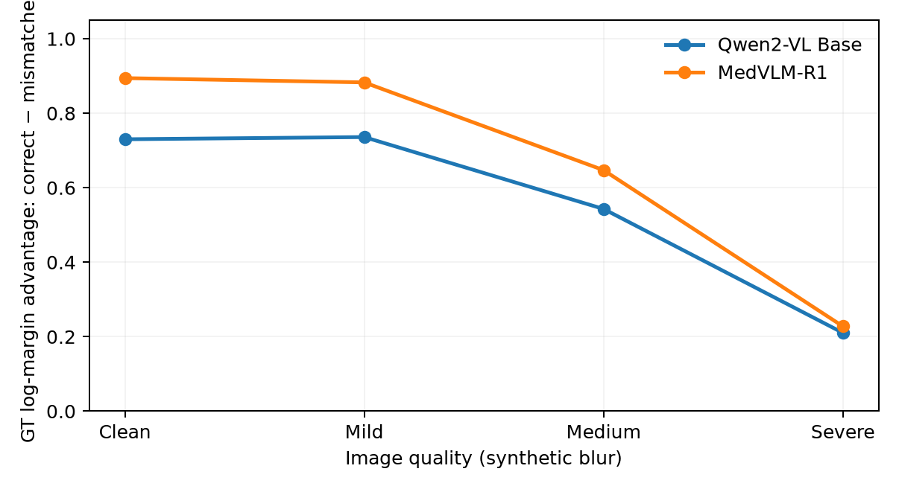
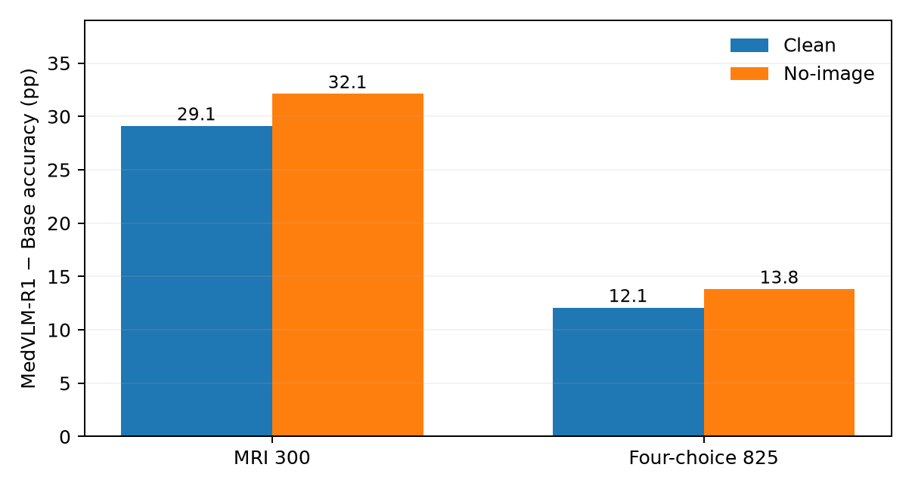

# Visual Reliance, Image Quality, and Non-Visual Gains in Medical VLMs

*Supporting experimental report | 9 October 2026*

This report expands the [one-page research brief](ONE_PAGE_SUMMARY.md) with experimental protocols, results, and hypotheses for follow-up. We compare the released Qwen2-VL-2B-Instruct and MedVLM-R1 checkpoints.

## 1. Experimental setup and measurements

**Checkpoints:** Qwen2-VL-2B-Instruct (Base) and MedVLM-R1 (RL). **Main evaluation:** official MedVLM-R1 medical-VQA 900 questions (MRI 300, CT 300, X-ray 300), including 825 four-choice questions used for the direct, matched 4-way comparison. **External checks:** VQA-RAD Yes/No (251 questions), SLAKE English Yes/No test (355, 96 images) and validation (358, 96 images), and PMC-VQA four-choice (frozen 1,000, 852 images). SLAKE and PMC-VQA use the same Base/RL checkpoint pair as the primary evaluation.

**Image interventions:** Clean retains the image paired with the question; No-image removes the image; Blank supplies an empty visual input; Mismatch replaces the original with a different real image while retaining exactly the same question and options; Blur degrades the *original* image with successively stronger synthetic blur. Mismatch preserves a real medical image while breaking its original question pairing; label-supported semantic-conflict pairs are evaluated separately. We kept the questions and displayed-answer sets fixed, counterbalanced option position, and mapped scores back to the same semantic option IDs.

For option-normalized probabilities \(p(y)\), let \(y^*\) be the correct choice. We measure:

- **Accuracy:** \(\mathbb{1}[\arg\max_y p(y)=y^*]\).
- **Signed GT probability margin:** \(M_p=p(y^*)-\max_{y\ne y^*}p(y)\).
- **Signed GT log margin:** \(M_{\log}=\log p(y^*)-\max_{y\ne y^*}\log p(y)\).
- **Answer entropy:** \(H=-\sum_y p(y)\log p(y)\).

A positive GT margin places the correct answer above every alternative; a negative margin indicates an incorrect top choice. Probability and log margins use different scales. Entropy summarizes uncertainty over the answer choices. The signed GT margin also differs from the conventional nonnegative top-1–top-2 gap on incorrect predictions.

## 2. Does the current image matter?

The 825-item four-choice evaluation yielded the following within-checkpoint accuracy changes under image interventions:

| Condition | MedVLM-R1, native answer generation | Qwen Base, direct candidate scoring |
|---|---:|---:|
| Clean | 81.5% | 64.7% |
| No-image | 55.7% | 43.4% |
| Different real image | 69.6% | 50.2% |
| Severe blur | 72.8% | 54.4% |

**Evaluation protocol:** MedVLM-R1 uses native answer generation in this table, while Base uses candidate scoring. We use the within-model condition changes to describe image sensitivity; Section 4 presents the direct Base/RL comparison using matched candidate scoring.

No-image removes the visual tokens, whereas Mismatch keeps the multimodal input structure and changes the image content. We therefore measure the correct-image advantage with \(M_{\log}(\mathrm{Clean})-M_{\log}(\mathrm{Mismatch})\). We also constructed 375 label-supported semantic-conflict pairs: 109 stronger mutually exclusive cases and 266 different-finding cases. These two tiers provide distinct levels of semantic contrast.

## 3. Does visual benefit change with image quality?

In a frozen 900-question matched-scoring quality × relevance experiment (both models using matched processing), we compare the gold-answer **log-margin** with the correct image to its log-margin with an unrelated real image at the same blur level:

| Quality | Base correct−mismatch | MedVLM-R1 correct−mismatch |
|---|---:|---:|
| Clean | 0.730 | 0.894 |
| Mild | 0.736 | 0.883 |
| Medium | 0.543 | 0.647 |
| Severe | 0.211 | 0.228 |

The correct-image advantage changes little from Clean to Mild blur, then decreases at greater degradation. This establishes a quality-conditioned change in visual benefit using a controlled synthetic-blur intervention; clinically rated diagnostic quality offers a complementary axis for future investigation.

In separate, original 825-item model-specific output analyses, signed **GT log margin** decreased with blur: Base 1.045 (Clean), 1.025 (Mild), 0.840 (Medium), 0.333 (Severe); MedVLM-R1 4.102, 3.982, 3.560, 2.184. We use these original, model-specific traces to characterize each checkpoint’s response across blur levels.

Answer-choice entropy rose substantially in the matched mechanism run: Base 0.756 (Clean) → 0.972 (Severe); MedVLM-R1 0.220 → 0.362. A layer-wise probe distinguished severe blur from clean inputs with best AUROC approximately 1.000 for both checkpoints. The probe quantifies the decodability of image degradation, alongside the behavioral changes in margin and entropy.

**When confidence sharpening diverges from answer quality.** In the label-supported semantic-conflict arm (375 samples), an image sometimes made the answer distribution sharper (entropy fell relative to No-image), but simultaneously *reduced* the signed correct-answer log margin. This pattern occurred in approximately 30.7% of Base cases and 23.5% of MedVLM-R1 cases in that arm. This divergence motivates evaluating visual evidence sensitivity together with signed correctness-aware margins. The analysis complements the visual-entropy perspective of [VES-RFT (CVPR 2026)](https://openaccess.thecvf.com/content/CVPR2026/html/Hou_VES-RFT_Rewarding_Visual_Evidence_Sensitivity_to_Mitigate_Hallucinations_in_Large_CVPR_2026_paper.html).

## 4. What improved after medical RL?

For the direct Base/RL comparison, we use **matched candidate scoring and three controlled answer-option orders for both checkpoints**. The accuracy shown is the mean of correctness across the orders.

| Evaluation | Base Clean | RL Clean | Base No-image | RL No-image | RL−Base Clean | RL−Base No-image |
|---|---:|---:|---:|---:|---:|---:|
| MRI 300 | 67.33% | 96.44% | 43.56% | 75.67% | **+29.11 pp** | **+32.11 pp** |
| Four-choice 825 | 68.89% | 80.97% | 44.12% | 57.94% | **+12.08 pp** | **+13.82 pp** |

The additional value of providing an image, \(\mathrm{Accuracy}_{\mathrm{Clean}}-\mathrm{Accuracy}_{\mathrm{NoImage}}\), changes after RL by **−3.00 pp** on MRI (95% CI approximately [−7.56, +1.67]) and **−1.74 pp** on all 825 four-choice questions (bootstrap CI approximately [−3.76, +0.40]). This difference-in-differences quantifies the change in observed image-presence benefit between the two checkpoints.

The 25% equal-choice baseline is substantially below Base No-image accuracy of **44.12%** on the 825 four-choice items: there are predictable non-visual signals in the question/option/task input, potentially including general medical knowledge and task/answer-distribution regularities. The large No-image uplift highlights **non-visual predictive capability** as an important contributor to post-training performance. We investigate three explanations: acquiring medical knowledge, improving use of existing knowledge, and strengthening task-specific question–answer priors.

**Previously successful image-conditioned questions.** We also isolated the original **506 four-choice items that both models answered correctly when the image was present** under the existing model-specific output protocols. On the 499 cases with both No-image results valid, **219** remained correct for both, **82** only for RL, **46** only for Base, **152** neither. Conditioning on shared Clean success isolates questions that both checkpoints could already solve with image input. The subsequent No-image comparison measures how strongly correct answers persist without the visual evidence, motivating further analysis of text-based answer tendencies.

## 5. Does the gain transfer across datasets?

The external benchmark comparisons below use a matched pair of Qwen2-VL-2B and MedVLM-R1 checkpoints, identical image substitutions, and matched option scoring. Image-clustered paired bootstrap 95% CIs are reported for the new external results.

| Dataset | Base Clean | RL Clean | RL−Base Clean | Base No-image | RL No-image |
|---|---:|---:|---:|---:|---:|
| SLAKE test (355) | 68.0% | 62.3% | **−5.8 pp** (CI [−9.1, −2.6]) | 45.4% | 42.7% |
| SLAKE validation (358) | 69.0% | 64.8% | **−4.2 pp** (CI [−7.2, −1.4]) | 44.1% | 43.2% |
| PMC-VQA (1,000) | 45.1% | 45.4% | **+0.3 pp** (CI [−0.6, +1.2]) | 31.4% | 31.1% |
| VQA-RAD Yes/No (251) | 61.8% | 63.5% | +1.8 pp | 51.8% | 54.8% |

The external RL−Base differences are substantially smaller than the +29.1 pp observed on MRI. This task-dependent pattern motivates closer analysis of question formats, answer distributions, visual domains, and training exposure.

A supplementary text-only DeepSeek screen and option-order check is documented in the reproducibility materials, along with frozen exploratory subsets. The main results use the complete fixed evaluation sets.

## 6. What next?

The next experiments will target two questions: (1) How much of the RL gain is reinforced through non-visual answer patterns? A matched image-free RL control can compare training with and without images using the same base, questions, and reward. (2) How does a model adjust visual reliance when evidence becomes clinically unreliable? Clinician-verified answer-opposed image pairs and expert-rated diagnostic quality can distinguish adaptive trust adjustment from the loss of readable image content.

### Reproducibility and source papers

The [repository README](../README.md) separates analysis reproduction from GPU inference reproduction and lists dataset/checkpoint access, controlled scoring, and files. Studies motivating this pilot include [VES-RFT (CVPR 2026)](https://openaccess.thecvf.com/content/CVPR2026/html/Hou_VES-RFT_Rewarding_Visual_Evidence_Sensitivity_to_Mitigate_Hallucinations_in_Large_CVPR_2026_paper.html), [SurgCheck (2026)](https://link.springer.com/article/10.1007/s11548-026-03739-4), [MedVLM-R1 (MICCAI 2025)](https://papers.miccai.org/miccai-2025/0553-Paper3267.html), and [reference-free whole-heart MR image quality assessment (2020)](https://pubs.rsna.org/doi/full/10.1148/ryai.2020190123).
