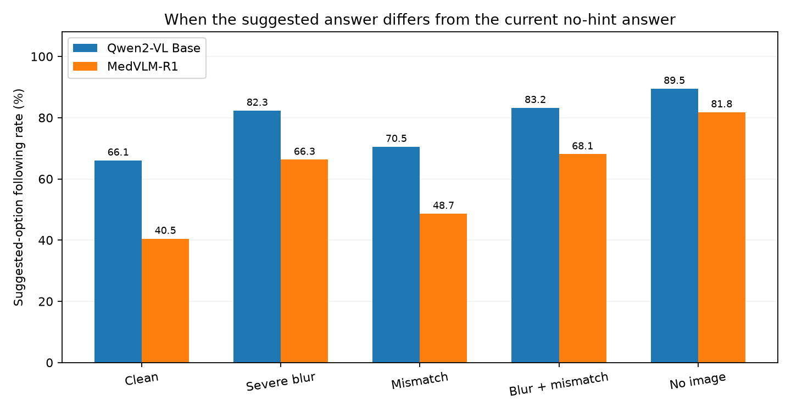
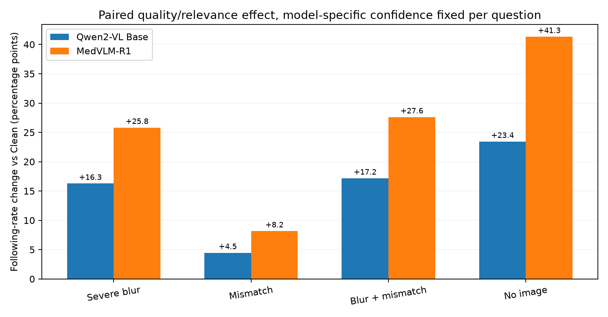

# Visual Evidence vs. Model-Specific Confidence-Calibrated Text Advice

**Status:** Full 559-item matched analysis.
**Cohort:** 559 questions on which both checkpoints predicted the original reference option correctly on Clean with matched four-option candidate scoring (O0). Full eligible cohort has MRI 207, CT 160, X-ray 192.

## Question and design

We ask whether changing the quality or pairing of visual input increases susceptibility to a fixed, numeric-confidence text suggestion, and whether this **within-checkpoint change** differs between the Base and the medically RL-trained checkpoint. We do not equate text susceptibility or entropy changes with direct proof of an explicit visual-trust mechanism.

For each eligible item, the checkpoint-specific Clean O0 highest-option probability is converted to a text-advice confidence by `25 + 0.5 × (100×p_clean−25)` percent. Once computed, the confidence is held **constant for that item/checkpoint across all five visual conditions and all four hinted options**. Each question is scored with no hint, then once each with suggestions of A, B, C, and D, using the otherwise identical answer instruction.

The five visual conditions are original Clean, Severe Blur of the original image, a fixed random real **same-modality Mismatch**, Severe Blur of the same mismatched image, and genuinely No-image. For Mismatch, the original label is **not automatically the correct diagnosis of the replacement image**. Matching and image quality are separate interventions.

**Important cross-check:** models receive *different* hint confidence values, as requested (their own initial Clean confidence). Absolute Base–R1 following rates thus jointly reflect checkpoint behavior and different prompt strengths. Within-checkpoint visual-condition differences are more interpretable; model interaction comparisons are descriptive, with paired CIs.

## Primary results

**Following rate** counts the fraction of the three suggestions **different from the current no-hint predicted option** that succeed in moving the final argmax to the suggested option. This is computed separately at every visual condition; it is not a majority vote over four prompted answers.

| Visual condition | Base: following | R1: following | Base: mean wrong-option probability lift | R1: lift |
|---|---:|---:|---:|---:|
| Clean | **66.1%** | **40.5%** | 37.7% | 30.8% |
| Severe Blur | **82.3%** | **66.3%** | 40.8% | 39.9% |
| Mismatch | **70.5%** | **48.7%** | 37.0% | 32.2% |
| Blur + Mismatch | **83.2%** | **68.1%** | 40.6% | 40.1% |
| No-image | **89.5%** | **81.8%** | 43.5% | 46.0% |

Wrong-option probability lift is the change in the probability assigned to the *hinted original non-reference option*, relative to its no-hint probability, averaged over three alternative semantic options. In Mismatch arms this is only an option-level shift relative to the **original** label; it is not necessarily wrong relative to the donor image.

## Within-model quality effects and Base/RL comparison

For each question and checkpoint, calculate following-rate change from that checkpoint’s **Clean** condition. The R1 minus Base effect below is the **paired difference in these changes**. All intervals use item-paired bootstrap over the same scored questions.

| Visual condition vs Clean | Base change (pp) | R1 change (pp) | R1 − Base interaction (pp, 95% CI) |
|---|---:|---:|---:|
| Severe Blur | +16.28 | +25.82 | **+9.54** [+6.98, +12.10] |
| Mismatch | +4.47 | +8.17 | **+3.70** [+1.19, +6.26] |
| Blur + Mismatch | +17.17 | +27.61 | **+10.44** [+7.75, +13.06] |
| No-image | +23.43 | +41.32 | **+17.89** [+15.21, +20.69] |

## Modality-specific change in advice susceptibility

The RL-trained checkpoint received medical RL on MRI data, so a pooled contrast can hide substantial between-modality differences. The table below uses **the same paired question IDs within each modality** and gives confidence intervals for the checkpoint interaction in severe-blur sensitivity.

| Modality | Shared Clean-correct n | Base: Severe − Clean | R1: Severe − Clean | R1 − Base (95% CI, pp) |
|---|---:|---:|---:|---:|
| MRI | 207 | +18.04 pp | +39.29 pp | **+21.26** [+16.26, +26.25] |
| CT | 160 | +14.17 pp | +17.50 pp | **+3.33** [-0.62, +7.29] |
| Xray | 192 | +16.15 pp | +18.23 pp | **+2.08** [-1.04, +5.38] |

The strong pooled Base/RL difference in severe-blur response is chiefly driven by MRI. In CT and X-ray the corresponding checkpoint-interaction intervals contain zero; these are exploratory subgroup comparisons, not evidence of equivalence.

## Previously correct answers: are they changed by wrong advice?

By construction, **every item is originally Clean-correct for both checkpoints**. For each visual arm we additionally restrict to items whose **no-hint response under that arm remains correct**, then calculate how often a suggestion of one of the three *originally wrong* options makes the final answer incorrect. The denominator is `3 × number of still-correct no-hint items`, not all 559×3 for degraded or no-image conditions.

| Visual condition | Base no-hint correct (n) | Base: originally correct → wrong | R1 no-hint correct (n) | R1: originally correct → wrong |
|---|---:|---:|---:|---:|
| Clean | 559/559 | 68.6% | 559/559 | 42.9% |
| Severe Blur | 398/559 | 79.6% | 446/559 | 63.3% |
| No-image | 288/559 | 85.3% | 348/559 | 77.2% |

We do not interpret original-label accuracy on Mismatch as diagnostic correctness without independent labels for the replacement images. For these arms, susceptibility to prompting is the principal measurement.

## Response stability and prompt confidence

**Answer stability** is the maximum number of times any single option is selected across four hinted answers divided by four; it is descriptive and does not replace the option-conditioned following rate.

| Visual condition | Base answer stability | R1 answer stability |
|---|---:|---:|
| Clean | 49.6% | 68.6% |
| Severe Blur | 37.9% | 49.8% |
| Mismatch | 46.4% | 62.6% |
| Blur + Mismatch | 37.3% | 48.3% |
| No-image | 32.6% | 38.3% |

Model-specific mean text confidence in this selection is **49.69% (Base)** and **56.07% (R1)**, frozen per question across image conditions. The numeric confidence controls are not calibrated claims about actual advice correctness.

## Interpretation and scope

The finding measures **behavioral susceptibility to a given text statement when visual conditions change**. It does not by itself prove that the model explicitly recognizes image quality and chooses to reduce visual reliance. Two particular caveats matter: (1) random Mismatch produces an alternative real medical image, which may itself contain meaningful evidence, and (2) the model-specific confidence rule gives Base and R1 different numerical statements. No-hint baseline shifts and probability lifts should accompany following rates; a separate shared-hint control would isolate prompt-strength differences if needed.

## Reproduction files

All files are relative to the enclosing `visual_advice_conflict_20261009` experiment folder:

- `reports/PROTOCOL.md`: the frozen design and metric definitions.
- `results/selection.json`: exact 559 question IDs, original gold index, each model’s source Clean confidence and derived hint confidence.
- `results/advice_qwen2vl.jsonl`, `results/advice_medvlmr1.jsonl`: all per-item, per-condition, per-option predictions and probability vectors, with prompt fingerprint.
- `results/per_item_metrics.csv`, `results/summary.json`: per-item derived metrics, model comparisons and question-paired bootstrap intervals.
- `scripts/prepare.py`, `scripts/run.py`, `scripts/analyze.py`, `scripts/verify.py`, `scripts/plot.py`: preparation, checkpoint-resumable GPU inference, analysis, validation, figures.
- For Mismatch+Blur, actual locally generated images are in `images/blurred_mismatch/`; the original clean, blur and donor images come from the existing frozen `medical/official900_visual_reliance_v1` assets.

**Record audit:** 559 complete question IDs × 5 visual conditions × 5 prompt settings × 2 checkpoints = 27,950 recorded predictions in this analysis. The final run expects 27,950 rows.
